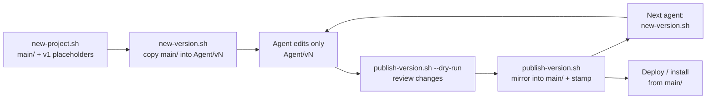

# How it works

## The problem

When you use more than one AI agent on the same work (Claude Code for one thing, Codex for another, Gemini for a third), they step on each other:

- Agent B edits the files Agent A is halfway through changing.
- Agent A comes back the next day, keeps working on its old copy, and silently undoes everything B did.
- Nobody can say which folder is the "real" version, or who changed it last.
- Each app invents its own place to save things (one Codex setup created `2026-10-25/<chat-title>/work/` folders at the top of the workspace), so files end up scattered by date instead of by project.

## The model

Every project has exactly one trusted version and one private working area per agent.

```
<workspace>/
  AGENTS.md                 house rules, read by every agent
  CLAUDE.md                 "@AGENTS.md" so Claude Code reads the same rules
  _scripts/                 the four scripts + config
  Agent Setup/              every agent's instructions, skills, memory
  Projects/
    coffee-landing/
      main/                 the trusted version
      LAST-EDITED-BY.md     who published main/, which version, when
      Claude/v1/ v2/        Claude's working copies
      Codex/v1/             Codex's working copy
      Gemini/v1/            placeholder
      Grok/v1/              placeholder
  Tasks/
    Gemini/compare-site-builders/    one-off work, not a shared project
```

Three rules hold it together:

1. **Work only in your own `<Agent>/<version>/` folder.** Read anything; write only there.
2. **Only `publish-version.sh` writes `main/`** (and `LAST-EDITED-BY.md`).
3. **Start every new piece of work from `main/`** with `new-version.sh`, never from your own last version.

## The lifecycle



### Start: `new-version.sh <project> <Agent>`

Copies the current `main/` into your next version folder and prints its path. If your highest version folder is an empty placeholder (like the `v1/` that `new-project.sh` creates), it fills that one; otherwise it creates the next number. `BRIEF.md` and `FEEDBACK.md` travel along because they live in `main/`.

Why from `main/` and not from your last version: another agent may have published since you last worked. If you continue in your old folder and publish, the mirror removes their files from `main/`.

### Work

Edit only inside the printed folder. Everything you produce (renders, screenshots, downloads, generated images) goes there too, so the next agent can find it.

### Publish: `publish-version.sh [--dry-run] <project> <Agent> <version>`

Mirrors your version folder into `main/` with `rsync --delete`: `main/` becomes an exact copy of your folder, minus build artifacts listed in `_scripts/publish-excludes.txt` (`node_modules`, `dist`, `.venv`, `.git`, ...). Then it writes `LAST-EDITED-BY.md`:

```markdown
# Last edited by

- **Agent:** Claude
- **Version:** v2
- **When:** 2026-10-31 16:54:34 +08
```

`--dry-run` lists every file that would be added, changed or deleted, without touching anything. A `*deleting` line you did not expect means your copy is stale: someone published after you started.

The script refuses to:

- publish an empty folder (that would wipe `main/`)
- accept an agent name that is not in `_scripts/agents.txt`, exact case (`claude` is not `Claude`)
- accept a version that is not `v1`, `v2`, `v3`, ... (no `2026-10-31`, no `final-final`)
- run without a `main/` folder (the project needs `new-project.sh` or a retrofit first)

### Hand off

The next agent has your folder, not your chat. So before stopping, you update `BRIEF.md` (what you started from, what the user wants, your decisions kept separate from their requirements, current state, next steps) and `FEEDBACK.md` (every piece of user feedback, dated, with status), put "Read BRIEF.md and FEEDBACK.md first" at the top of `README.md`, and publish.

### Deploy from `main/`

Anything that runs somewhere persistent is built and deployed from `main/`:

- Your working copy may be half broken mid-edit. `main/` is the last known-good state.
- If you deploy from a working copy, what runs and what `main/` says stop matching, and nobody can trust `main/` anymore.
- Build artifacts are never published, so run a fresh install and build in `main/` first.
- A background process can outlive the app that started it. Stop any instance running from an old location before trusting the new build.

## Naming rules

- Version folders: `v1`, `v2`, `v3`. Nothing else.
- Projects and tasks: a short name for what they are (`coffee-landing`, `q3-pricing-report`).
- Never a folder named after a date, a timestamp or a chat title, and never `work/` + `outputs/` session folders. Some agent apps create these by default for every chat. The house rules forbid them, `new-project.sh` and `publish-version.sh` reject dated names, and `check-workspace.sh` flags any that appear.

## One-off tasks

Not everything is a shared project. Quick research, a one-time file conversion, a throwaway script: these go in `Tasks/<Agent>/<task-name>/`. If a task grows into something another agent will also touch, promote it: `new-project.sh <name>`, copy the files into your `<Agent>/v1/`, publish.

## Flat projects and the retrofit

A project folder that holds its files directly (no `main/`, no agent folders) predates the convention. Before anyone edits it again, it is retrofitted:

1. Delete regenerable build artifacts.
2. Create `main/` and a `v1/` for every agent, not just your own.
3. Move the files into your own `<Agent>/v1/`.
4. Publish, which creates `main/` and `LAST-EDITED-BY.md`.
5. Fix anything that hardcoded the old absolute path.

The `agents-workspace` skill has the exact commands in `references/retrofit.md`.

## Groups and collections

- **Groups**: a folder inside `Projects/` whose children are each projects (`Projects/Client Sites/acme/main/`). Address them by path: `new-project.sh "Client Sites/acme"`.
- **Collections**: a folder outside `Projects/` that uses the same structure (say `Marketing/Social Posts/<post>/`). Add `posts=Marketing/Social Posts` to `_scripts/collections.txt` and use `posts:<name>` with every script.

## Agent Setup: one home for all agent config

Each tool keeps its global instructions and skills in its own home folder (`~/.claude`, `~/.codex`, `~/.gemini/config`, `~/.grok`). Instead of maintaining four copies, the real files live in `<workspace>/Agent Setup/` and each tool's path is a link into it:

- `Agent Setup/skills/<name>/`: every custom skill, so all agents share them
- `Agent Setup/instructions/<agent>/`: each agent's global instructions, which include a short version of the house rules with the agent's own name filled in
- `Agent Setup/memory/`, `knowledge/`, `automations/`, `External Skills/`

You edit the files in `Agent Setup/`, never through the links, and never replace a link with a real file. See [agent-setup.md](agent-setup.md).

## Moving or renaming folders

Agent apps remember chats and projects by absolute folder path. Rename a folder and Claude Code, Codex and Antigravity each lose track of it in their own way, usually without an error. So nobody moves a workspace folder casually: quit the apps, use a script written for that one move (with a dry run), and re-add the folder through each app's UI where needed. Antigravity in particular keeps its state in SQLite and must only be moved through its own UI.

## Why folders and not git

Work here is sequential: one agent works, publishes, the next picks up. Copy-and-stamp is easy to inspect, needs no merge, and never asks an agent to resolve a conflict it might get wrong. If your work becomes truly concurrent, you can put individual projects under git later without changing the structure. (You can still keep a version folder in git yourself: `publish-version.sh` never copies `.git` into `main/`.)
